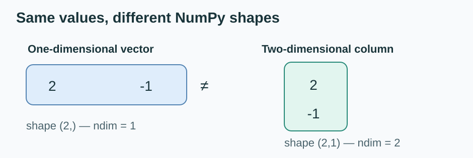

# NumPy Matrices, Broadcasting and the Neural-Layer Bridge

**Practiced on 15 October 2026.** This file is the **Python syntax guide**. For the mathematical derivation, use [ML-MATH](https://github.com/Vaibh37/ML-MATH/tree/main/linear-algebra/matrices).

## 1. One 2D array, several rows

~~~python
import numpy as np
A = np.array([[1, 2, 3],
              [4, 5, 6]])
print(A.ndim)   # 2
print(A.shape)  # (2, 3)
~~~

There are **two inner lists** (two rows) but **one NumPy 2D array**. A shape is (rows, columns).

## 2. Matrix multiplication: @, not *

~~~python
A = np.array([[1, 2], [3, 4]])
B = np.array([[5, 6], [7, 8]])
print(A * B)
# [[ 5 12]
#  [21 32]]
print(A @ B)
# [[19 22]
#  [43 50]]
~~~

The * operator multiplies matching elements; @ multiplies rows by columns and sums the products.

### Rectangular example

~~~python
A = np.array([[1, 2, 3], [4, 5, 6]])   # (2, 3)
B = np.array([[7, 8], [9, 10], [11, 12]]) # (3, 2)
C = A @ B
print(C)
# [[ 58  64]
#  [139 154]]
print(C.shape)  # (2, 2)
~~~

Inner dimensions (3 and 3) match. Outer dimensions (2 and 2) determine result shape.

## 3. Transpose

~~~python
print(A.T)
# [[1 4]
#  [2 5]
#  [3 6]]
print(A.T.shape)  # (3, 2)
~~~

A.T swaps the axes of this 2D array, so the shape changes from (2,3) to (3,2).

## 4. A 1D vector is not a 2D column array

~~~python
x = np.array([2, -1])          # shape (2,)
column_x = np.array([[2], [-1]])  # shape (2, 1)
print(x.shape)
print(column_x.shape)
~~~

Both hold two values, but they have **different numbers of array axes**.

## 5. Broadcasting a row versus a column

~~~python
A = np.array([[5, 10], [15, 20], [25, 30]]) # (3, 2)
row = np.array([[2, 3]])                     # (1, 2)
print(A + row)
# [[ 7 13]
#  [17 23]
#  [27 33]]
~~~

For each dimension from the right, sizes must match or one must be 1.

Column broadcasting:

~~~python
WX = np.array([[19, 22], [43, 50]])    # (2,2)
bias = np.array([[1], [2]])            # (2,1)
print(WX + bias)  # [[20 23], [45 52]]
~~~

The column bias is used for **every column** of WX. This does not imply that NumPy must allocate copies of the bias.

## 6. One dense hidden-layer forward pass

~~~python
W = np.array([[2, 1], [-1, 3], [1, -2]]) # (3,2)
x = np.array([[2], [-1]])                # (2,1)
b = np.array([[1], [2], [-3]])           # (3,1)

Z = W @ x + b
A = np.maximum(0, Z)  # ReLU, elementwise

print(Z.ravel()) # [ 4 -3  1]
print(A.ravel()) # [4 0 1]
print(A.shape)   # (3,1)
~~~

**Important:** This is *inference/forward computation* with chosen parameters, not a trained model. To learn the neuron arithmetic, use [Neural-Network](https://github.com/Vaibh37/Neural-Network/blob/main/notes/04-hidden-layer-forward-pass.md).

## Practice — predict before running

1. What is the shape of (3,2) @ (2,5)?
2. Does (3,4) + (2,4) broadcast?
3. What is the difference between x.shape == (2,) and x.shape == (2,1)?
4. Why do we keep a column-oriented bias as (number_of_neurons,1)?

Use [examples/matrix_operations.py](examples/matrix_operations.py) to check runnable values.
